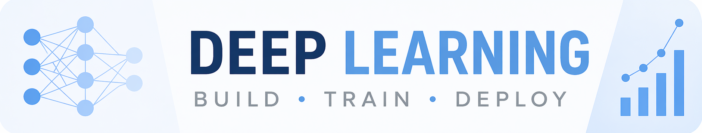

# 深度学习笔记

[](https://github.com/datawhalechina/deep-learning-notes/actions/workflows/quarto-ci.yml)
[](https://github.com/datawhalechina/deep-learning-notes/actions/workflows/dnnlpy-ci.yml)
[](https://www.python.org/)
[](https://pytorch.org/)
[](https://huggingface.co/docs/transformers/index)

[English](README.md) | **简体中文**



关于怎么学深度学习，我困扰了很久。

《动手学深度学习》是一本很好的入门书，但深度学习，尤其是大模型相关技术的发展速度实在太快。Transformer 之后，大模型逐渐成为重要方向，而围绕大模型，又逐渐出现了数据处理、训练优化、模型评测、推理系统和 post-training 等越来越多的内容。网上的资料虽然很多，却往往散落在论文、博客、课程和代码仓库里。学着学着就很容易变成一堆彼此独立的知识点，很难真正串成一条完整的线。

所以我想，把自己学习过程中遇到的内容慢慢整理下来。这份笔记从神经网络简介、PyTorch、优化算法、CNN 和 RNN 等基础内容开始，逐渐学习 attention、Transformer，再继续往 LLM 方向深入，包括从零实现 GPT-2、大模型训练工程、数据处理、scaling laws、模型评测、LLM inference、post-training，以及 vLLM 和 SGLang 这样的推理框架。

当然，我自己也还在持续学习，所以这个仓库是一份不断更新的学习记录。我会尽量把自己学到的，理解过的东西写清楚，也把公式、代码和实际 project 联系起来。如果你也在自学深度学习，希望这些笔记能给你一些帮助。

> [!NOTE]
> **AI 辅助写作：** 本教程的写作过程中使用了 LLM 辅助生成初稿。每次生成后，我都会自行 review，并根据自己的理解对内容、逻辑和表述进行修改。发布前，我也会进一步检查相关代码和技术细节。尽管如此，内容中仍可能存在疏漏或错误，欢迎指出并提出修改建议。

## 📌 关于这份笔记

本项目目前主要使用 **Quarto Markdown** 进行维护和发布，并构建为静态网站。Quarto Markdown 是一种基于 Markdown 的纯文本格式，适合版本控制和持续更新。

内容主要包括：

- 神经网络基础、PyTorch、MLP 与优化算法
- CNN、正则化与归一化
- RNN、LSTM、GRU 与 Seq2Seq
- Attention、Transformer、FlashAttention
- MiniGPT 的实现与训练、Tokenizer 和 GPT-2
- LLM 训练工程
- vLLM 和 SGLang 的推理与优化

项目对应的 Jupyter Notebook 版本在 [jshn9515/dnnl-notebooks](https://github.com/jshn9515/dnnl-notebooks)。这个仓库会与主仓库保持同步，其中的 notebooks 可以直接在 Google Colab 中打开。GitHub Actions Artifacts 也可以作为备用来源，在仓库同步失败或暂时不可用时，用于获取最新的构建输出。

如果你希望自己从源码生成 notebook，也可以在本地安装 Quarto 后，使用 `quarto convert` 命令将 `.qmd` 文件转换为 Jupyter Notebook。例如：

```bash
quarto convert path/to/file.qmd
```

## 🔧 环境配置

本仓库所有代码已在以下环境测试通过：

- Python 3.14
- PyTorch 2.14

完整依赖见 `pyproject.toml`。

在运行相关内容之前，请先安装 `dnnlpy` 库。这个库包含了笔记中使用的一些自定义实现和工具函数，安装完成后才能正常运行相关代码。

```bash
uv pip install dnnlpy
```

如果你想直接从本仓库安装最新版本，可以使用：

```bash
uv pip install "git+https://github.com/datawhalechina/deep-learning-notes.git#subdirectory=dnnlpy"
```

> [!NOTE]
> 本项目使用 **Transformers v5**。如果你参考的其他仓库或教程基于 v4，API 会有较大差异（如分词器、量化配置等），请参考 [官方迁移指南](https://github.com/huggingface/transformers/blob/main/MIGRATION_GUIDE_V5.md) 进行调整。

## 🤝 贡献

如果你发现某个概念解释得不够清楚、某段代码有问题，或者有你希望我补充的主题，欢迎通过 Issue 或 Pull Request 参与改进。

你可以贡献的内容包括但不限于：

- 指出笔记中的错误或不准确之处
- 补充更清晰的解释、公式推导或代码注释
- 提出排版、结构或表达上的改进建议
- 建议我后续补充的主题或案例

由于这是我在自学过程中持续整理的项目，难免会有理解不到位或表述不够准确的地方。所有有帮助的反馈，我都会认真阅读并尽量及时改进。

如果你想提交较大的修改，建议先开一个 Issue 简单说明想法，方便提前沟通。

## 🙏 致谢

在整理这些笔记的过程中，我参考了不少优秀的资源。尤其是李沐老师的《动手学深度学习》和李宏毅教授的深度学习系列课程，对我理解深度学习中的许多核心概念帮助很大。

本项目网站使用 [Quarto](https://quarto.org/) 搭建。

本书封面设计灵感来源于 [_Understanding Deep Learning_](https://udlbook.github.io/udlbook/)。

## 📄 许可证

- 本仓库中的笔记内容采用 **CC BY-NC 4.0 协议**
- `dnnlpy` 库采用 **MIT 协议**。

## ⭐ Star History

[](https://www.star-history.com/?repos=jshn9515%2Fdeep-learning-notes&type=date&legend=top-left)
